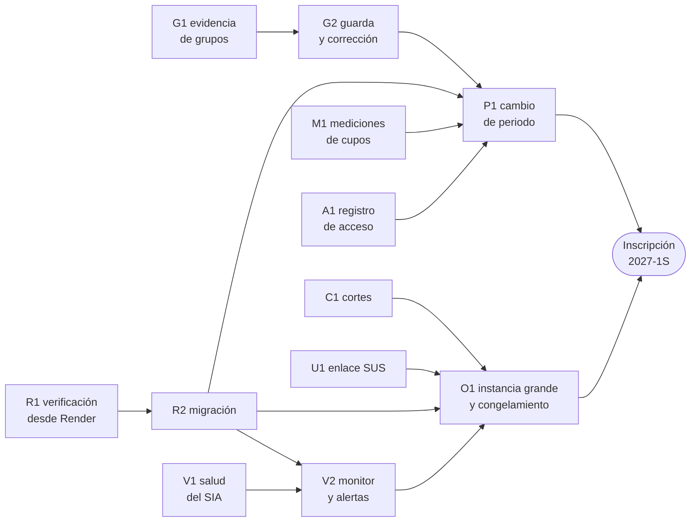

# Plan para la inscripción de 2027-1S

Qué hay que dejar hecho en SIA Bridge **antes de que abra la inscripción de asignaturas de
2027-1S**. Es la fase 0 de la propuesta de Trabajo de Grado (instrumentación y migración),
más lo que falta para que el sistema aguante esa inscripción.

Este documento planea; no describe el sistema. El contexto del Trabajo de Grado está en
[README.md](README.md) y el detalle de cada actividad en [METODOLOGIA.md](METODOLOGIA.md). La arquitectura está en [ARCH.md](../ARCH.md),
las trampas del SIA en [GOTCHAS.md](../GOTCHAS.md) y las cifras del sistema solo en
[CONSTANTS.md](../CONSTANTS.md): aquí se nombran por su constante. Las cifras que sí aparecen
son del plan (horas, tamaños de instancia, precios de la propuesta).

Cada ítem es un PR aparte, con el tipo de commit que pide
[COMMIT-CONVENTION.md](../COMMIT-CONVENTION.md). Un merge a `main` que toque `internal/**`,
`cmd/bridge/**`, `web/**` o `migrations/**` despliega solo.

---

## Fecha objetivo

**La fecha de apertura de la inscripción de 2027-1S no está en el repositorio.** Es el
primer pendiente (ver [Decisiones pendientes](#decisiones-pendientes), DP-1). Todo el plan
se cuenta hacia atrás desde esa fecha, que aquí se llama **T**.

| Cuándo | Qué tiene que estar hecho |
|---|---|
| Ya, sin esperar a T | G1 (evidencia del error de grupos, mientras el SIA muestre 2026-2S) y R1 (verificación desde Render) |
| T − 6 semanas | G2, M1 y A1 fusionados y desplegados |
| T − 5 semanas | R2: migración a Render terminada, o contingencia activada |
| T − 4 semanas | V1, V2 y U1 desplegados. Desde aquí se mide |
| T − 3 semanas | Colchón. Lo imprescindible que no esté desplegado en **T − 1 semana** se descarta y pasa a la actividad 6 de la propuesta |
| T − 1 semana | C1 probado, corte previo tomado, congelamiento de `main` |
| T − 3 días | O1: instancia grande activa. P1: `SIA_TERM` cambiado, apenas el SIA muestre 2027-1S |
| T a T + 4 semanas | Inscripción: cortes de C1, vigilancia |
| T + 4 semanas | O1: volver a la instancia pequeña |

Si T queda a menos de seis semanas de hoy, se comprime el colchón y no se toca el orden.

---

## Resumen

Horas-persona estimadas, no medidas.

| Id | Ítem | Compromiso de la propuesta | Tipo de commit | Horas | Prioridad |
|---|---|---|---|---|---|
| G1 | Evidencia del error de identificación de grupos | 4 | `test:` | 2 a 4 | Imprescindible |
| G2 | Guarda y corrección de claves de grupo repetidas | 4 | `fix:` | 3 a 6 | Imprescindible |
| M1 | Registro de cada medición de cupos | 2 | `feat:` | 2 a 4 | Imprescindible |
| A1 | Registro de acceso persistente | 3 | `feat:` | 4 a 7 | Imprescindible |
| U1 | Enlace al cuestionario SUS | 5 | `feat:` | 2 a 4 | Imprescindible |
| R1 | Verificación del flujo contra el SIA desde Render | 1 | `build:` | 3 a 5 | Imprescindible |
| R2 | Migración a Render | 1 | `ci:` y `fix:` | 5 a 9 | Imprescindible |
| V1 | Salud del camino al SIA en un endpoint | aguantar la inscripción | `feat:` | 1 a 2 | Imprescindible |
| V2 | Monitor externo y alertas | aguantar la inscripción | sin PR | 1 a 2 | Imprescindible |
| P1 | Cambio de periodo | 6 | sin PR | 0,5 a 1 | Imprescindible |
| C1 | Cortes fechados de 2027-1S | 6 | `chore:` | 2 a 4 | Imprescindible |
| O1 | Instancia grande y congelamiento de `main` | 1 | sin PR | 0,5 a 1 | Imprescindible |
| X1 | Aviso cuando las fechas del detalle no cuadran con `SIA_TERM` | protege 6 | `fix:` | 1 a 2 | Deseable |
| X2 | Guion de incidentes en Render | aguantar la inscripción | `docs:` | 1 a 2 | Deseable |
| X3 | Consulta de invariantes guardada en el repo | adelanta la actividad 4 | `chore:` | 1 a 2 | Deseable |
| X4 | Limpieza de ramas y de PRs de dependencias | higiene | sin PR | 0,5 a 1 | Deseable |

**Total imprescindible: 26 a 49 h. Total deseable: 3,5 a 7 h.**

Si hay que recortar, el orden de sacrificio es: X4, X3, X2, X1, y después U1 (la propuesta
ya prevé que el SUS se reporte solo con las tareas guiadas). G2, M1 y A1 no se recortan:
sin ellos 2027-1S no sirve como fuente de datos.

---

## Orden de ejecución



Tres carriles que no se bloquean entre sí hasta el final:

- **Datos** (G1, G2, M1, A1): cambios de código que funcionan igual en el servidor actual
  y en Render. No dependen de la migración, y por eso sobreviven a la contingencia.
- **Plataforma** (R1, R2, V1, V2): R1 va primero porque decide si hay migración.
- **Operación** (U1, C1, P1, O1): lo último, con la plataforma ya definida.

`R2 → P1` no es una dependencia técnica: es para que la serie de 2027-1S empiece ya en la
plataforma definitiva. Si se activa la contingencia, P1 se hace sobre el servidor actual.

---

## Ítems imprescindibles

### G1. Evidencia del error de identificación de grupos

- **Qué y por qué.** En 214 grupos de 2026-2S, dos grupos distintos de una asignatura se
  guardaron como uno porque la respuesta del SIA repetía la clave, y la serie de cupos
  alterna entre dos valores. No se sabe qué forma de la página lo produce y ningún fixture
  lo reproduce. Compromiso 4 de la fase 0. **Es urgente y no depende de T**: el SIA solo
  muestra el periodo vigente, y cuando pase a 2027-1S la oferta que produjo el error deja
  de ser consultable.
- **Cómo.**
  1. Sin tocar el SIA: restaurar el corte del 2026-11-20 en la base local y listar los
     grupos afectados (dos registros de `seat_snapshot` del mismo `section_id` con
     milisegundos de diferencia). De cada uno: sede, asignatura, `key`, `label`, `site` y
     los planes que lo ven. Clasificarlos: claves numéricas frente a claves con sede, y
     cuántas asignaturas concentran los 214.
  2. Contra el SIA, a mano y a baja tasa: con la colección `bruno/sia-catalogo/` (01 a 08)
     o un test con `SIA_LIVE=1`, pedir el detalle de dos o tres de esas asignaturas desde
     un plan que vea los grupos repetidos. Empezar por `1101/1000001-B`.
  3. Guardar la respuesta mínima que reproduce el caso como fixture, con el nombre y la
     fecha que pide [DEVELOPMENT.md](../DEVELOPMENT.md#fixtures), y un test que hoy falle:
     afirma que las claves de un detalle son únicas.
- **Hipótesis a contrastar.** (a) La asignatura tiene dos componentes (por ejemplo teórico
  y práctico), cada uno con su propio código de componente y su propia numeración de
  grupos. La cabecera ya trae ese código antes del primer grupo, y `extractGroupKey` lo
  descarta. (b) El SIA reutiliza un token de sede para dos grupos distintos.
- **Archivos.** `internal/sia/testdata/` (fixture nuevo), `internal/sia/parse_detail_test.go`.
- **Migración.** No.
- **Terminado cuando.** Hay un fixture real con claves repetidas y un test que lo carga y
  falla por la razón esperada; o bien queda escrito, con las consultas hechas, que el SIA
  ya no muestra el caso (entonces G2 sigue con fixture sintético y DP-3).
- **Riesgo.** Que el SIA ya haya cambiado de periodo o que el caso no se reproduzca desde
  los planes probados. No bloquea G2, pero sí la entrada en GOTCHAS.
- **Dependencias.** Ninguna. Requiere el corte del 2026-11-20, que ya existe.
- **Commit.** `test: fixture de detalle con claves de grupo repetidas`. Puede ir en el
  mismo PR que G2 si se hacen seguidos.
- **Horas.** 2 a 4.

### G2. Guarda y corrección de claves de grupo repetidas

- **Qué y por qué.** `ParseDetail` comprueba que haya tantos `Profesor:` como grupos, pero
  no que las claves sean únicas. `UpsertDetail` hace upsert por
  `(campus_code, code, term, key)` sin guarda: el segundo grupo pisa al primero dentro de
  la misma transacción y deja dos registros de cupos. Compromiso 4.
- **Cómo.** Dos capas, para que el error no pueda volver en silencio:
  1. **Parser.** Al terminar de armar los grupos, `ParseDetail` detecta claves repetidas y
     las vuelve distintas con la regla que salga de G1 (ver DP-3). Cada repetición deja un
     `slog.Warn` con plan, asignatura y las cabeceras crudas de los grupos implicados.
  2. **Store.** `UpsertDetail` rechaza con error una oferta que traiga dos grupos con la
     misma clave. Después del parser nunca debería dispararse: es la guarda que hoy falta.
- **Evidencia en GOTCHAS.** Solo si G1 consiguió el fixture real: sección nueva al final
  de [GOTCHAS.md](../GOTCHAS.md), con la fecha, lo medido (cuántos grupos, qué forma tiene la
  cabecera), la regla y el nombre del fixture y del test, y la fila correspondiente en la
  tabla "Dónde vive cada trampa" de [ARCH.md](../ARCH.md). **Sin evidencia nueva GOTCHAS no se
  edita**: la hipótesis queda en el cuerpo del PR y en un comentario del parser, y la
  entrada se escribe cuando la guarda atrape el primer caso en producción.
- **Archivos.** `internal/sia/parse_detail.go`, `internal/sia/parse_detail_test.go`,
  `internal/store/section.go`, `internal/store/store_test.go`, `docs/GOTCHAS.md` y
  `docs/ARCH.md` (con evidencia), `docs/DATA-MODEL.md` (decisión 8, si cambia la identidad).
- **Migración.** No, salvo que DP-3 decida meter el componente en la clave única. Los
  grupos de 2027-1S son filas nuevas (`term` distinto): no hay datos que convertir. La
  historia de 2026-2S de esos 214 grupos no se repara; se excluye, como dice la propuesta.
- **Terminado cuando.** El test de G1 pasa; un test del store comprueba que dos grupos con
  la misma clave dan error y no escriben nada; todos los fixtures existentes siguen
  parseando igual; y, ya con M1 desplegado, esta consulta devuelve cero filas tras una
  semana de tráfico: grupos con dos mediciones a menos de un segundo de distancia.
- **Riesgo.** Si la regla usa el orden de la página y el SIA cambia ese orden entre dos
  respuestas, las dos series se intercambian. Por eso se prefiere una regla anclada a un
  dato de la página (DP-3). Riesgo menor: las claves nuevas aparecen en la URL
  `/sections/{key}`; hay que comprobar que la interfaz no asume claves sin sufijo.
- **Dependencias.** G1 (o su resultado negativo). Debe estar desplegado antes de P1.
- **Commit.** `fix(sia): no fundir grupos que repiten la clave en un detalle`.
- **Horas.** 3 a 6.

### M1. Registro de cada medición de cupos

- **Qué y por qué.** `seat_snapshot` solo crece cuando el número cambia
  ([DATA-MODEL.md](../DATA-MODEL.md), decisión 4), así que no se sabe cuántas veces se miró
  un grupo sin que cambiara. El estimador de frecuencia de cambio de la propuesta necesita
  cada medición con su hora. Compromiso 2.
- **Diseño.** Tabla nueva, solo de inserción. `seat_snapshot`, la vista `current_seats` y
  `section.seats_checked_at` no cambian: la API sigue leyendo de ahí.

  ```sql
  CREATE TABLE seat_measurement (
      section_id      bigint NOT NULL REFERENCES section(id) ON DELETE CASCADE,
      program_id      bigint NOT NULL,   -- plan desde el que se midió
      available_seats int    NOT NULL,
      measured_at     timestamptz NOT NULL
  );
  CREATE INDEX ON seat_measurement USING brin (measured_at);
  ```

  Un `INSERT` por grupo con cupos dentro de la transacción de `UpsertDetail`, junto al
  `UPDATE` de `seats_checked_at` y con el mismo `MeasuredAt`. Sin clave primaria ni índice
  B-tree: la tabla se analiza fuera de línea sobre un corte, y un BRIN sobre la hora cuesta
  kilobytes. `program_id` sin llave foránea, para que apagar o reordenar la referencia no
  toque el historial. El `Refresher` manual entra por el mismo upsert, así que sus
  mediciones también quedan.
- **Costo en almacenamiento.** Unos 60 bytes por fila. El número de filas es
  (detalles que fueron al SIA) × (grupos por asignatura), y no se conoce: 2026-2S dejó
  117 316 cambios y unas 3,3 millones de consultas de detalle acumuladas, de las que solo
  una fracción fue al SIA. Con uno a cinco millones de mediciones por inscripción son
  **60 a 300 MB**. Se mide el tamaño real al final de la primera semana
  (`pg_total_relation_size`) y se proyecta; ver DP-6 por el efecto en el almacenamiento
  contratado.
- **Retención.** Todo se conserva hasta la entrega del informe final. Después de cada
  corte verificado (C1) los datos también viven fuera del servidor. Al cerrar el Trabajo
  de Grado se decide si la tabla se vacía por periodo (DP-7).
- **Archivos.** `migrations/00006_seat_measurement.sql`, `internal/store/section.go`,
  `internal/store/store_test.go`, `docs/DATA-MODEL.md` (decisión 4 y la tabla de apoyo),
  `docs/DIAGRAMS.md` (modelo de datos).
- **Migración.** `00006`, solo crea. La bajada borra la tabla: **nunca
  `make migrate-down` en producción**. Correr `make migrate-test` en local.
- **Terminado cuando.** Un test del store hace dos `UpsertDetail` con los mismos cupos y
  encuentra dos filas en `seat_measurement` y una en `seat_snapshot`; en producción, tras
  un día, `count(*)` de la tabla supera al número de registros nuevos de `seat_snapshot`.
- **Riesgo.** Bajo. Un insert más por grupo en una transacción que ya hace varios. Si el
  volumen real supera la estimación, crece el disco (solo puede crecer, no encoger).
- **Dependencias.** Ninguna. Conviene que salga antes que G2 para usarlo en su verificación.
- **Commit.** `feat: registrar cada medición de cupos, cambie o no`.
- **Horas.** 2 a 4.

### A1. Registro de acceso persistente

- **Qué y por qué.** La duración de cada petición solo sale en el log
  (`requestLogger` en `internal/httpapi/middleware.go`), y los logs se pierden: cada
  despliegue recrea el contenedor, y en una plataforma administrada la retención es de
  días. La simulación de la propuesta usa las horas reales de petición de 2027-1S.
  Compromiso 3. Va en Postgres y no en el log del proxy para que funcione igual en Render
  y en el servidor actual.
- **Diseño.**

  ```sql
  CREATE TABLE access_log (
      at           timestamptz NOT NULL,
      route        text NOT NULL,     -- plantilla de la ruta, no la URL
      campus       text,
      program      text,
      code         text,
      section_key  text,
      max_age_s    int,               -- NULL si el cliente no lo pidió
      background   boolean NOT NULL,
      status       smallint NOT NULL,
      dur_us       int NOT NULL,      -- microsegundos: un acierto dura pocos ms
      x_cache      text,
      sia_fetch_ms int
  );
  CREATE INDEX ON access_log USING brin (at);
  ```

  - **Qué se registra.** Solo las rutas bajo `/v1/campuses/`. Ni `healthz`, ni `status`,
    ni la documentación.
  - **Qué no se registra, a propósito.** IP, `User-Agent`, `X-Request-Id`, y el texto de
    búsqueda (`q`), que es lo que alguien escribió. Nada que permita seguir a una persona
    de una petición a otra.
  - **Cómo.** Un middleware nuevo en `httpapi`, después del handler: lee la plantilla con
    `c.FullPath()`, los parámetros de ruta, `max_age` y `background` de la consulta, y
    `X-Cache` y `X-SIA-Fetch-Ms` de las cabeceras de la respuesta. Escribe sin sumar
    latencia, con el mismo patrón que `recordDemand`: fuera del camino de la respuesta y
    con un contexto que no muere con la petición. El hexágono se respeta: método nuevo en
    el puerto `Store` (`internal/catalog/ports.go`), paso por `catalog.Service`, e
    implementación en `internal/store`. `httpapi` no importa `store`.
  - **Si la base falla**, el registro se pierde y se cuenta en el log; la petición nunca
    falla por esto.
- **Costo en almacenamiento.** Unos 130 a 150 bytes por fila, sobre todo por la plantilla
  de la ruta. Con el tráfico de 2026-2S como techo (unas 3,3 millones de consultas de
  detalle, que incluían mediciones automáticas que la interfaz ya no hace) son
  **hasta unos 500 MB por inscripción**. Si al medir la primera semana pesa demasiado, la
  plantilla se cambia por una etiqueta corta; no se hace antes.
- **Retención.** La misma que M1.
- **Archivos.** `migrations/00007_access_log.sql`, `internal/httpapi/middleware.go`,
  `internal/httpapi/router.go`, `internal/httpapi/middleware_test.go`,
  `internal/catalog/ports.go`, `internal/catalog/service_refresh.go` (junto a
  `RecordDemand`), `internal/store/` (archivo nuevo o `seats.go`), los dobles de `Store` en
  los tests de `catalog` y `httpapi`, `docs/DATA-MODEL.md`, `docs/API.md` (una línea: qué se
  registra y qué no), `web/` no cambia.
- **Migración.** `00007`, solo crea.
- **Terminado cuando.** Un test de `httpapi` pide un detalle con `?max_age=0&background=1`
  y encuentra una fila con ruta, plan, asignatura, `max_age_s = 0`, `background = true`,
  estado, duración y `x_cache`; otro comprueba que `/v1/healthz` no deja fila;
  `hexagon_test.go` sigue pasando; y en producción la tabla no tiene ninguna columna de
  IP ni de identificador.
- **Riesgo.** Una escritura por petición contra una base pequeña. En el pico de la
  inscripción puede competir con las lecturas: si el p90 de un acierto empeora de forma
  visible tras desplegarlo, se agrupan las escrituras en lotes. No se hace antes de medir.
- **Dependencias.** Ninguna.
- **Commit.** `feat: registro de acceso persistente sin datos personales`.
- **Horas.** 4 a 7.

### U1. Enlace al cuestionario SUS

- **Qué y por qué.** La propuesta recoge el SUS por dos vías: tras las tareas guiadas y
  por un enlace abierto en la interfaz. Compromiso 5. Lo más simple que sirve: un
  formulario externo y un enlace.
- **Cómo.**
  1. Formulario externo (ver DP-5) con los diez ítems del SUS en español, escala de 1 a 5,
     un párrafo de consentimiento informado sobre el uso de las respuestas (Ley 1581 de
     2012) y un campo opcional de sugerencias. **Sin recoger correo, sin exigir inicio de
     sesión y sin preguntas que identifiquen.**
  2. Enlace en el colofón de `web/src/components/Layout.tsx`, en español, que abre en
     pestaña nueva. La URL va como constante en el código: no es secreta, y cerrar la
     recolección en la semana 5 se hace cerrando el formulario, sin desplegar.
  3. Al tocar la interfaz se usa la skill `ui-ux-pro-max`, y los estilos salen de
     `web/src/styles/tokens.css`.
- **Archivos.** `web/src/components/Layout.tsx`, `web/src/components/Layout.css`, su test
  si lo hay.
- **Migración.** No.
- **Terminado cuando.** El enlace se ve en todas las pantallas, en móvil y escritorio, con
  foco visible y texto que dice a dónde lleva; una respuesta de prueba llega al formulario
  sin pedir cuenta ni correo; `npm run lint`, `npm test` y `npm run build` pasan.
- **Riesgo.** Bajo. Sesgo de autoselección, que la propuesta ya declara.
- **Dependencias.** DP-5. El texto de los ítems y del consentimiento lo aprueba el director.
- **Commit.** `feat(web): enlace al cuestionario de usabilidad`.
- **Horas.** 2 a 4, contando armar el formulario.

### R1. Verificación del flujo contra el SIA desde Render

- **Qué y por qué.** La propuesta condiciona la migración a comprobar, desde la
  plataforma, que el SIA responde igual. El riesgo es concreto: el SIA cambia de respuesta
  según quién pregunta ([GOTCHAS §1](../GOTCHAS.md)) y nada garantiza que trate igual a un
  centro de datos extranjero con IPs de salida compartidas. Compromiso 1. **Va cuanto
  antes**: su resultado decide si existe R2 o se activa la contingencia.
- **Cómo.** Sin tocar producción ni el DNS:
  1. Crear en Render, en la región de Estados Unidos más cercana a Bogotá, un Postgres
     vacío y el servicio de la API desde el `Dockerfile`, en la instancia pequeña, con
     `SIA_POOL_SIZE` en el valor de `DefaultPoolSize`. Aplicar las migraciones.
  2. Por la URL `onrender.com`, a mano y una sola vez cada cosa: niveles y sedes; el
     directorio de programas de una sede; el catálogo de un plan de pregrado (las dos
     consultas, regular y electivas); el detalle de una asignatura con muchos grupos, de
     una de libre elección y de una de un plan de doctorado; y un segundo detalle seguido
     en el mismo plan (región numerada, [GOTCHAS §20](../GOTCHAS.md)).
  3. Comparar cada respuesta con la de producción: mismas filas, mismos grupos, mismas
     claves.
  4. Dejar el servicio una hora sin tráfico y mirar `/v1/status`: los contadores `sia` no
     deben acumular no-ops ni fallos (el keepalive sigue vivo) y `last_ok` debe avanzar al
     repetir una petición.
  5. Anotar lo que haya que volver a medir desde la región: la latencia por POST
     (`SIA_POST_LATENCY`) y el costo del bootstrap (`SIA_BOOTSTRAP_COST`). Si difieren de
     [CONSTANTS.md](../CONSTANTS.md), se actualiza la tabla con la medición nueva en R2.
  6. De paso, resolver lo que R2 necesita saber: qué IP ve `c.ClientIP()` detrás del
     proxy de Render, qué versión mayor de Postgres ofrece la plataforma frente a la de
     `docker-compose.yml`, si están las extensiones `pg_trgm` y `unaccent`, y la memoria
     del proceso en reposo.
- **Archivos.** `render.yaml` (Blueprint nuevo en la raíz: servicio web con Docker, sitio
  estático y base de datos). Es lo único que entra al repo en este ítem.
- **Migración.** Las cinco existentes, sobre la base vacía.
- **Terminado cuando.** Los pasos 2 a 4 pasan sin un solo `sia_noop` atribuible a la
  región, y queda una nota con lo medido en el paso 5 y lo averiguado en el 6. **Si el
  bootstrap llega con el tamaño de `SIA_BROWSER_UA_BYTES`, si hay no-ops persistentes o
  si el SIA rechaza la conexión, la verificación falla** y se activa la
  [contingencia](#contingencia).
- **Riesgo.** Que pase hoy y el SIA bloquee después. Lo cubre V2, y el servidor actual
  queda disponible hasta T + 4 semanas.
- **Dependencias.** Ninguna. Cuesta días prorrateados de la instancia pequeña y de la base.
- **Commit.** `build: blueprint de render para la api, la interfaz y la base`.
- **Horas.** 3 a 5.

### R2. Migración a Render

- **Qué y por qué.** El 24 de septiembre de 2026 el sistema dejó de responder por una
  falla del alojamiento. Se deja de depender de un servidor personal. Compromiso 1.
- **Piezas.**

  | Pieza | Hoy | En Render |
  |---|---|---|
  | API | contenedor `api` detrás de Caddy | servicio web con Docker, chequeo de salud en `/v1/healthz` |
  | Interfaz | contenedor `web` (nginx) que reenvía `/v1` | sitio estático: `npm ci && npm run build`, publica `web/dist`, regla de SPA a `index.html` |
  | Base | contenedor `db` con bind mount | Postgres administrado, URL interna |
  | Migraciones | `make migrate` por SSH | antes de cada despliegue, y si fallan el despliegue se cancela (DP-2) |
  | Versión y Release | `semantic-release` en `deploy.yml` | igual: sigue en GitHub Actions |
  | `Refresher` | `make run-jobs` en el servidor | no se despliega; si hace falta, a mano desde la máquina del autor contra la URL externa |
  | `web-test` | `sia-test.gabotachak.dev` | no se migra; lo reemplazan las vistas previas de PR del sitio estático |

- **Pasos.**
  1. **Código y configuración, antes del corte.**
     - `internal/httpapi/router.go`: que `c.ClientIP()` devuelva la IP del cliente detrás
       del proxy de Render. **Es lo más delicado de la migración**: si todas las peticiones
       parecen venir de la misma IP, el balde `RATE_LIMIT_*` se vuelve un límite para todos
       los usuarios juntos y `foregroundPerIP` manda casi todo el tráfico al carril de
       fondo. El comentario de `NewRouter` ya pide verificarlo en cada despliegue nuevo.
     - Cómo llega la interfaz a la API sin el nginx que hoy reenvía `/v1` (DP-4).
     - `DATABASE_URL` con `pool_max_conns` explícito, como en `docker-compose.yml`: sin
       él, pgx abre un puñado de conexiones según las CPU de la instancia.
     - `TZ` igual que en `.env.example`. `PORT` lo pone la plataforma y el binario ya lo lee.
     - Memoria: ver el apartado siguiente.
     - `.github/workflows/deploy.yml`: el paso de SSH se reemplaza por el disparo del
       despliegue en Render; se conservan `semantic-release`, el filtro por rutas y el
       chequeo final contra `/v1/healthz`.
  2. **Corte fechado previo**, con el procedimiento de C1, guardado fuera del servidor.
     Es el "otro corte" que pide la propuesta.
  3. **Traslado de datos**, en una franja de poco uso: detener la API actual, `pg_dump`,
     suma de verificación, `pg_restore --no-owner --no-acl` en Render, y comparar el
     conteo de filas de `section`, `seat_snapshot`, `course_demand` y `refresh_run` con el
     origen. La tabla de versiones de goose viaja en el volcado.
  4. **DNS**: `sia.gabotachak.dev` al sitio estático y `sia-api.gabotachak.dev` al
     servicio. Esperar los certificados.
  5. **Comprobación**: la interfaz carga un plan y un detalle; `/v1/version` responde;
     `/v1/status` muestra `sia` sano; dos clientes en redes distintas no comparten balde.
  6. **Documentación**, que describe cómo funciona hoy: `docs/COMMANDS.md` entero,
     `docs/DEVELOPMENT.md`, la sección de despliegue de `docs/DIAGRAMS.md`, "Una sola
     instancia" de `docs/ARCH.md`, `README.md` y `README.es.md` a la par, `CLAUDE.md` si
     nombra el despliegue, y `.env.example` con las variables nuevas.
  7. **El servidor actual no se desmonta** hasta T + 4 semanas: es la vuelta atrás.
- **Memoria y tamaño del pool.** La instancia general tiene 0,5 CPU y 512 MB; la del mes
  de inscripción, 1 CPU y 2 GB.
  - En reposo una conexión cuesta poco: el llenado del pool trae un bootstrap a la vez. El
    pico es otro: tras un tropiezo del SIA, cada operación en vuelo re-bootstrapea su
    conexión, y pueden coincidir hasta `SIA_POOL_SIZE` cuerpos de hasta el techo de
    `SIA_BOOTSTRAP_COST` (cada uno acotado por `maxBodySize`), más las copias del parseo.
    Con el valor de producción de `SIA_POOL_SIZE` eso es más de una cuarta parte de la
    memoria de la instancia pequeña solo en cuerpos crudos.
  - **Recomendación.** `GOMEMLIMIT` en torno al 75 % de la memoria de la instancia, en las
    dos (es un límite blando: hace trabajar antes al recolector, no evita un pico real).
    En la instancia pequeña, además, `SIA_POOL_SIZE` reducido: fuera de inscripción la
    carga no lo necesita, y cada conexión viva le cuesta al SIA un POST de keepalive cada
    `keepaliveIdle`. En la instancia grande, `SIA_POOL_SIZE` como está hoy en producción.
    El valor exacto para la pequeña sale de mirar la memoria en las métricas de Render
    durante R1 y los primeros días: sin reinicios por memoria en 48 h y pico por debajo
    del 70 %.
  - **Invariante durante un despliegue.** Render arranca la versión nueva antes de retirar
    la vieja, así que por unos minutos hay dos pools: dos veces `SIA_POOL_SIZE` tiene que
    respetar `maxTotalConnections`. Y mientras corra un `Refresher` manual no se despliega.
  - `GOMEMLIMIT` y el tamaño del pool son variables de entorno: cambiarlas con el plan es
    parte de O1.
- **Archivos.** `render.yaml`, `.github/workflows/deploy.yml`, `Dockerfile` (si DP-2 mete
  las migraciones en la imagen), `internal/httpapi/router.go` y su test,
  `web/src/api/client.ts` y `web/vite.config.ts` (según DP-4), `.env.example`, y la
  documentación del paso 6. `docker-compose.yml` y `deploy/` se quedan: son el entorno
  local y la vuelta atrás.
- **Migración.** Ninguna nueva.
- **Terminado cuando.** Un merge a `main` que toque `internal/**` queda desplegado en
  Render con su Release, sin SSH; los conteos del paso 3 coinciden; el paso 5 pasa; y un
  acierto de catálogo no tarda visiblemente más que antes (se compara la mediana de diez
  peticiones contra la del servidor actual).
- **Riesgo.** (1) La IP del cliente mal resuelta: se prueba explícitamente. (2) La base
  de 256 MB de memoria es más chica que el servidor actual: si las lecturas del catálogo
  se degradan, se sube el plan de la base, fuera del presupuesto de la propuesta. (3) La
  latencia hasta el SIA sube al salir de Colombia: se mide en R1. (4) El despliegue sin
  corte duplica el pool por minutos. (5) Un error en el traslado: el corte previo y el
  servidor intacto lo cubren.
- **Dependencias.** R1 aprobado; DP-2 y DP-4 resueltas. El traslado de datos lo ejecuta el
  autor: toca producción y el DNS.
- **Commits.** Tres PRs: `fix(httpapi): resolver la ip del cliente detrás del proxy de render`,
  `ci: desplegar en render en vez de ssh`, `docs: operación y despliegue en render`.
- **Horas.** 5 a 9.

### V1. Salud del camino al SIA en un endpoint

- **Qué y por qué.** El 20 de septiembre de 2026 `/v1/healthz` respondía bien mientras la
  mayoría de las peticiones al SIA salían `502 sia_noop` ([GOTCHAS §41](../GOTCHAS.md)). Los
  contadores que lo delataban ya existen en `/v1/status` (`sia`: `noops`,
  `fetches_failed`, `last_ok`), pero son acumulados y un monitor externo no sabe leerlos.
  Hace falta una respuesta de sí o no.
- **Cómo.** Ruta nueva, por ejemplo `GET /v1/healthz/sia`: `200` si el camino al SIA
  funciona y `503` si en una ventana reciente hubo fallos y ningún éxito. **No consulta al
  SIA**: solo lee el estado que el pool ya lleva, así que vigilarla cada pocos minutos no
  genera ni un POST. El chequeo de salud de la plataforma sigue en `/v1/healthz`: un SIA
  caído no debe reiniciar el proceso en bucle.
- **Archivos.** `internal/httpapi/status.go`, `internal/httpapi/router.go`,
  `internal/httpapi/httpapi_test.go`, `internal/catalog/background.go` y
  `internal/sia/pool.go` si falta un dato con ventana, `internal/httpapi/openapi.yaml`,
  `docs/API.md`, `bruno/bridge-api/`, y `docs/CONSTANTS.md` con la ventana como constante
  nueva (`constants_doc_test.go` la vigila).
- **Migración.** No.
- **Terminado cuando.** Un test con una fuente que solo falla obtiene `503` pasada la
  ventana, y `200` tras el primer éxito; con la fuente sin tráfico obtiene `200`.
- **Riesgo.** Falsos positivos de madrugada si la ventana es corta. Empezar holgada.
- **Dependencias.** Ninguna.
- **Commit.** `feat: exponer la salud del camino al sia para monitoreo`.
- **Horas.** 1 a 2.

### V2. Monitor externo y alertas

- **Qué y por qué.** Los dos incidentes de 2026-2S se detectaron tarde. Lo mínimo para la
  inscripción es enterarse en minutos, sin depender de mirar la página.
- **Cómo.** Un servicio externo gratuito de disponibilidad (DP-5), con tres chequeos cada
  cinco minutos y aviso al teléfono:
  1. `https://sia.gabotachak.dev` (la interfaz);
  2. `https://sia-api.gabotachak.dev/v1/healthz` (el proceso);
  3. `https://sia-api.gabotachak.dev/v1/healthz/sia` (el camino al SIA).

  Más las notificaciones propias de Render por despliegue fallido y servicio no saludable.
  Ningún chequeo fuerza una consulta al SIA ni usa `max_age=0`.
- **Archivos.** Ninguno. La configuración se anota en `docs/COMMANDS.md` dentro del PR de
  documentación de R2 o de X2.
- **Terminado cuando.** Detener el servicio a propósito unos minutos, en una franja de
  poco uso, produce una alerta en el teléfono, y otra al volver.
- **Riesgo.** Bajo. Que la alerta llegue y nadie pueda atenderla: X2 deja escrito qué
  hacer en cinco minutos.
- **Dependencias.** V1 y R2 (las URL definitivas).
- **Commit.** Sin PR.
- **Horas.** 1 a 2.

### P1. Cambio de periodo

- **Qué y por qué.** `term` sale de `SIA_TERM`, no del SIA. Una medición con el periodo
  viejo cuando el SIA ya muestra 2027-1S escribe sobre las filas de 2026-2S y mezcla dos
  periodos en una serie. Compromiso 6: sin esto los cortes de 2027-1S no sirven.
- **Cómo.**
  1. Comprobar a mano, con la colección `bruno/sia-catalogo/` (01 a 08), que el detalle de
     una asignatura trae fechas de 2027.
  2. Solo entonces cambiar `SIA_TERM` en el servicio (el valor nuevo tiene el formato del
     que está en `.env.example`) y actualizar ese archivo en un PR.
  3. Pedir un detalle y comprobar que los grupos nuevos quedan con el periodo nuevo y que
     los de 2026-2S no cambiaron.
- **Archivos.** `.env.example`, `render.yaml` si fija el valor.
- **Migración.** No. `term` está en la clave única: 2027-1S crea filas nuevas.
- **Terminado cuando.** `SELECT term, count(*) FROM section GROUP BY term` muestra los dos
  periodos, y `max(fetched_at)` de 2026-2S es anterior al cambio.
- **Riesgo.** La ventana entre que el SIA cambia y se cambia la variable: toda medición en
  ese lapso contamina 2026-2S. El corte del 2026-11-20 protege los datos del Trabajo de
  Grado; X1 acorta la ventana. `course_demand` no tiene periodo y sigue acumulando: para
  2027-1S la demanda sale de `access_log`.
- **Dependencias.** G2, M1 y A1 desplegados, para que la serie de 2027-1S nazca limpia.
- **Commit.** `chore: periodo 2027-1 en el ejemplo de entorno`.
- **Horas.** 0,5 a 1.

### C1. Cortes fechados de 2027-1S

- **Qué y por qué.** La actividad 1 de la propuesta analiza cortes fechados y verificables
  de la base. Compromiso 6.
- **Cómo.** Un objetivo `make snapshot` que hace `pg_dump` en formato comprimido contra la
  URL que reciba, nombra el archivo con la hora en UTC como el corte existente
  (`sia-bridge-prod-<fecha>.dump`) y escribe su `sha256` al lado. Se ejecuta desde la
  máquina del autor contra la URL externa de la base, con la lista de IPs permitidas
  abierta solo para ese momento. El archivo se copia a `~/Backups/sia-unal-bridge` y a
  Drive. El primero se prueba restaurándolo en la base local.

  | Corte | Cuándo |
  |---|---|
  | Previo a la migración | paso 2 de R2 |
  | Previo a la inscripción | T − 1 día, ya con `SIA_TERM` nuevo |
  | Semanal | al final de cada semana de inscripción |
  | Cierre | al terminar la inscripción y los ajustes |

- **Archivos.** `Makefile`, `docs/COMMANDS.md`.
- **Migración.** No.
- **Terminado cuando.** Un corte de prueba se restaura en local, su suma coincide con la
  guardada y los conteos de `seat_measurement` y `access_log` coinciden con el origen.
- **Riesgo.** Olvidar un corte semanal. No es grave: las tablas son solo de inserción y el
  corte siguiente lo contiene todo. Lo grave es no tener el de cierre antes de volver a la
  instancia pequeña o de tocar el esquema.
- **Dependencias.** Para los cortes de inscripción, R2, M1 y A1.
- **Commit.** `chore: objetivo de make para cortes fechados de la base`.
- **Horas.** 2 a 4, contando la ejecución durante la inscripción.

### O1. Instancia grande y congelamiento de `main`

- **Qué y por qué.** La propuesta paga la instancia de 1 CPU y 2 GB durante el mes de la
  inscripción; el cobro es prorrateado y el plan nuevo entra en el siguiente despliegue.
  Y un merge que toque `internal/**` despliega solo: en plena inscripción, un despliegue
  es un pool entero que vuelve a hacer bootstrap.
- **Cómo.**
  1. En T − 3 días: cambiar el plan, subir `SIA_POOL_SIZE` y `GOMEMLIMIT` a los valores de
     la instancia grande (R2) y forzar un despliegue. Comprobar en `/v1/status` que el
     pool se llenó.
  2. Desde T − 1 semana hasta T + 1 semana: no se fusiona a `main` nada que despliegue,
     salvo una corrección urgente. Los PRs de dependencias esperan.
  3. En T + 4 semanas, con el corte de cierre tomado: volver a la instancia pequeña y a
     sus valores.
- **Archivos.** `render.yaml` si fija el plan.
- **Terminado cuando.** El panel muestra el plan grande, el servicio no se reinició por
  memoria en 48 h y `main` no recibe merges que desplieguen en la ventana.
- **Riesgo.** Olvidar bajar el plan: cuesta dinero, no datos. Ponerlo en el calendario.
- **Dependencias.** R2, V2, C1, U1.
- **Commit.** Sin PR, o `chore:` si cambia `render.yaml`.
- **Horas.** 0,5 a 1.

---

## Ítems deseables

### X1. Aviso cuando las fechas del detalle no cuadran con `SIA_TERM`

- **Qué y por qué.** Acorta la ventana de riesgo de P1. Cada grupo trae su fecha de inicio
  (`start_date`); si el año y el semestre de esa fecha no corresponden a `SIA_TERM`, el
  servicio lo dice con un `slog.Warn` y un contador en `/v1/status`. Solo avisa: negarse a
  escribir es una decisión de más peso (los grupos PEAMA tienen calendario propio,
  [GOTCHAS §27](../GOTCHAS.md)) y no se toma aquí.
- **Archivos.** `internal/catalog/service_refresh.go`, su test, `internal/httpapi/status.go`.
- **Terminado cuando.** Un test con un detalle de fechas de otro año deja el aviso.
- **Riesgo.** Falsos avisos por calendarios PEAMA o cursos intersemestrales.
- **Dependencias.** Ninguna. Sirve solo si sale antes de P1.
- **Commit.** `fix: avisar cuando el periodo configurado no cuadra con el detalle`.
- **Horas.** 1 a 2.

### X2. Guion de incidentes en Render

- **Qué y por qué.** Una página en `docs/COMMANDS.md` para actuar en cinco minutos:
  reiniciar el servicio, volver al despliegue anterior, leer los logs, quitar o poner el
  banner de incidencia (`VITE_INCIDENT_BANNER_OFF`), y el diagnóstico de
  [GOTCHAS §41](../GOTCHAS.md): si todo da `sia_noop` y la colección Bruno funciona, mirar
  `/v1/status` y reiniciar.
- **Archivos.** `docs/COMMANDS.md`.
- **Commit.** `docs: guion de incidentes en render`.
- **Horas.** 1 a 2.

### X3. Consulta de invariantes guardada en el repo

- **Qué y por qué.** La actividad 4 de la propuesta añade una comprobación automática de
  invariantes sobre toda la base (claves de grupo repetidas, series que alternan entre dos
  valores). Dejar ya las consultas en un archivo, usadas a mano en G1 y G2, adelanta ese
  trabajo. Automatizarlas en la integración continua queda para la actividad 4.
- **Archivos.** Un `.sql` bajo `deploy/` o `docs/`, y una línea en `docs/COMMANDS.md`.
- **Commit.** `chore: consultas de invariantes de grupos y cupos`.
- **Horas.** 1 a 2.

### X4. Limpieza de ramas y de PRs de dependencias

- **Qué y por qué.** Antes del congelamiento: fusionar o cerrar los PRs abiertos de
  Dependabot (el de la acción de `semantic-release` cambia de versión mayor y toca el
  mismo `deploy.yml` que R2: va antes o después de R2, no a la vez), y borrar las ramas
  remotas ya fusionadas.
- **Horas.** 0,5 a 1.

---

## Lo que se revisó y no hace falta

- **Ramas sin fusionar.** `feat/catalog-stale-while-revalidate`,
  `fix/auto-measure-seats-transition` y `feat/web-donors-david-julian` no tienen commits
  que falten en `main`: su contenido ya está. La única rama remota con trabajo sin fusionar
  es `origin/feature/ultimate-sync`, un bucle de refresco continuo contra el SIA: **no se
  fusiona**, va contra la decisión de no hacer barridos periódicos.
- **Incidente del 20 de septiembre** (cookie jar): corregido, con su test
  (`TestDo_RebootstrapStartsFromAnEmptyCookieJar`) y su entrada en
  [GOTCHAS §41](../GOTCHAS.md). Lo que faltaba era detectarlo: V1 y V2.
- **Incidente del 24 de septiembre** (alojamiento): R1 y R2.
- **El `Refresher`** sigue siendo una herramienta manual. Este plan no lo programa ni
  propone barridos periódicos, y ningún ítem incluye pruebas de carga contra el SIA.
- **Redis, réplicas, autoescalado**: no. El proceso asume una sola instancia
  ([ARCH.md](../ARCH.md)) y el presupuesto también.

---

## Contingencia

Si R1 falla (el SIA no responde igual desde Render), **la migración se pospone** y la
inscripción se atiende desde el servidor actual, como dice la propuesta:

- G1, G2, M1, A1, U1, V1, P1 y C1 no cambian: ninguno depende de la plataforma. Se
  despliegan con el `deploy.yml` actual.
- R2 y O1 no se hacen. Se borran los recursos de prueba de Render para no pagarlos.
- Hay que comprobar que `sia.gabotachak.dev` y `sia-api.gabotachak.dev` responden desde
  el servidor actual y, si no, republicarlos (Caddy y DNS; la causa de la caída de
  septiembre no está diagnosticada): 1 a 3 h, inciertas.
- V2 apunta a las mismas URL. Es más importante todavía: el alojamiento ya falló una vez.
- Los cortes de C1 se toman contra la base del servidor.

Si lo que falla es el tiempo, vale la regla de la propuesta: lo no desplegado antes de la
inscripción pasa a la actividad 6, el objetivo 2 se reporta solo con mediciones
controladas y el SUS solo con las tareas guiadas.

---

## Lista de verificación del día antes (T − 1)

Plataforma:

- [ ] `/v1/version` muestra la versión esperada y `/v1/healthz` responde.
- [ ] `/v1/status`: `sia` con `last_ok` reciente y sin no-ops ni fallos creciendo.
- [ ] `/v1/healthz/sia` responde `200`.
- [ ] La instancia grande está activa, con su `SIA_POOL_SIZE` y su `GOMEMLIMIT`.
- [ ] Sin reinicios por memoria en las últimas 48 h.
- [ ] Dos veces `SIA_POOL_SIZE` respeta `maxTotalConnections`.
- [ ] Almacenamiento de la base con margen: uso por debajo de la mitad.
- [ ] Los tres chequeos del monitor están en verde y la alerta de prueba llegó al teléfono.

Datos:

- [ ] El SIA muestra 2027-1S y `SIA_TERM` ya es el periodo nuevo.
- [ ] Un detalle pedido hoy creó filas en `seat_measurement` y en `access_log`.
- [ ] `access_log` no tiene columnas ni valores que identifiquen a nadie.
- [ ] Ningún grupo tiene dos mediciones a menos de un segundo (la consulta de G2).
- [ ] Corte previo a la inscripción tomado, con su suma, copiado a `~/Backups` y a Drive.

SIA:

- [ ] La colección `bruno/sia-catalogo/` corre de 01 a 08 sin no-ops.
- [ ] La interfaz carga un plan, un detalle y Mi semestre desde un teléfono.

Operación:

- [ ] `main` congelada: sin PRs por fusionar que desplieguen.
- [ ] El cron del `Refresher` sigue pausado y nadie lo va a correr a mano durante la apertura.
- [ ] El enlace al SUS abre el formulario, y el formulario acepta respuestas.
- [ ] El banner de incidencia está apagado y se sabe cómo prenderlo.
- [ ] El servidor anterior sigue disponible como vuelta atrás.
- [ ] En el calendario: cortes semanales, corte de cierre y bajada de plan en T + 4 semanas.

Durante la inscripción, una vez al día: mirar las métricas de memoria, el tamaño de
`seat_measurement` y `access_log`, y buscar en los logs el aviso de claves repetidas de G2.

---

## Decisiones pendientes

No se tomaron aquí porque son de producto, de arquitectura o dependen de un dato que falta.
Cada una trae la recomendación.

| | Decisión | Recomendación | Quién |
|---|---|---|---|
| DP-1 | **Fecha de apertura de la inscripción de 2027-1S (T).** No está en el repo | Tomarla del calendario académico apenas se publique y fijar las fechas de la tabla inicial. Mientras tanto, G1 y R1 no esperan | Autor |
| DP-2 | **Quién construye la imagen y quién corre las migraciones en Render.** (a) Render construye desde el `Dockerfile` y GitHub Actions solo dispara el despliegue; (b) Actions construye, publica la imagen y Render la ejecuta. Y las migraciones: como comando previo al despliegue con goose y `migrations/` dentro de la imagen, o desde Actions contra la URL externa | (b) para la imagen, porque Actions ya conoce la etiqueta y el commit que hoy se hornean (`GIT_TAG`, `GIT_SHA`) y Render no; y migraciones como comando previo al despliegue, para no abrir la base a los corredores de GitHub. Confirmar en R1 | Autor |
| DP-3 | **Identidad de un grupo cuando el SIA repite la clave.** Cambia lo que significa `key` en `section` y en la URL `/sections/{key}` | Esperar a G1. Si la causa es el componente, anclar la clave al código de componente, que es estable entre respuestas. Si no hay evidencia antes de T − 6 semanas, sufijo por orden de aparición más el aviso en el log, como solución provisional declarada | Autor, con la evidencia |
| DP-4 | **Cómo llega la interfaz a la API sin nginx.** (a) Regla de reescritura del sitio estático hacia la API, si Render la sirve como proxy y conserva la IP del cliente; (b) la interfaz llama a `sia-api.gabotachak.dev` y la API abre CORS solo para el origen de la interfaz; (c) nginx como segundo servicio, fuera del presupuesto | Probar (a) en R1: no cambia código. Si no reenvía o esconde la IP, (b): unas 2 a 3 h más en R2, y hay que exponer las cabeceras `Age` y `X-Cache` | Autor |
| DP-5 | **Servicios externos**: con qué se arma el formulario SUS y qué monitor de disponibilidad se usa | Un formulario de Google sin recolección de correo, y cualquier monitor gratuito con chequeo cada cinco minutos y aviso al teléfono | Autor |
| DP-6 | **Almacenamiento de la base.** La propuesta presupuesta 1 GB. M1 y A1 pueden sumar hasta unos 800 MB por inscripción en el peor caso, y el siguiente escalón de la plataforma es mayor | Empezar en 1 GB, medir al final de la primera semana y ampliar si la proyección pasa del 70 %. La diferencia es de pocos dólares en los cinco meses; se declara en el informe | Autor |
| DP-7 | **Retención de `seat_measurement` y `access_log` al terminar el Trabajo de Grado** | Conservar todo hasta la nota. Después, dejar en la base solo el periodo vigente y el resto en cortes | Autor |
| DP-8 | **Texto del SUS en español y del consentimiento**, y si el formulario pregunta algo más que los diez ítems | Usar la versión en español validada del SUS (Sevilla-Gonzalez et al., 2020), la misma que cita la propuesta, y no preguntar nada más que sugerencias | Director |
| DP-9 | **Si la guarda de periodo (X1) debe negarse a escribir** en vez de avisar | Solo avisar en 2027-1S; decidir con los avisos reales en la mano | Autor |
