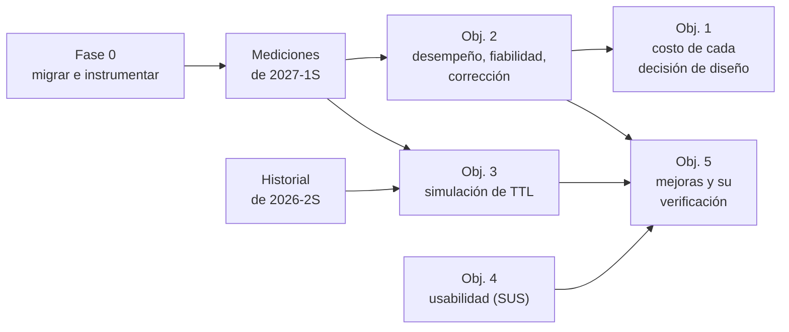

# Trabajo de Grado: plan

Plan del Trabajo de Grado (Ingeniería de Sistemas y Computación, UNAL Bogotá, periodo
2027-1S) que usa SIA Bridge como objeto de estudio. No es una copia del formato de la
Universidad ni documentación del sistema: reúne qué se evalúa, con qué datos, en qué
orden y qué riesgos hay. La arquitectura sigue en [ARCH.md](../ARCH.md) y las cifras del
sistema en [CONSTANTS.md](../CONSTANTS.md).

## Estado

Al 2026-11-20 la propuesta final está escrita en el formato de la Universidad:
[propuesta en Google Docs](https://docs.google.com/document/d/1N_WznN1ROOjKW4DYWCx6C34PZaLPR0RmJHp__fbVTiw/edit).
Si este documento y la propuesta difieren, manda la propuesta; aquí se explica el porqué
y se registran las decisiones que la propuesta no recoge.

El enfoque cambió. El plan anterior era un estudio cuantitativo de la frescura de los
cupos. La propuesta final es una **evaluación de calidad de software** (ISO/IEC 25010 e
ISO/IEC 25012) con **mejora del sistema**; la simulación de tiempos de vida de la caché
queda como un objetivo entre cinco.

## Trabajo previo y qué se califica

- **Trabajo previo:** SIA Bridge (desarrollado desde agosto de 2026 y usado en la
  inscripción de 2026-2S), su documentación técnica y sus pruebas automatizadas.
- **Se califica lo posterior al registro:** el análisis de diseño, las mediciones, la
  simulación, la evaluación con usuarios, la instrumentación y las mejoras, con su
  evidencia, y el informe.

La propuesta lo declara así. Nada de lo leído en el Acuerdo 037 prohíbe partir de un
trabajo previo.

## Lo que exige la norma

Acuerdo 037 de 2017 del Consejo de Facultad de Ingeniería, sede Bogotá. Texto leído
completo en el Régimen Legal de la UNAL (`legal.unal.edu.co/rlunal/home/doc.jsp?d_i=88861`).

| Artículo | Requisito |
|---|---|
| Art. 2 | Modalidad: Trabajos investigativos, Proyecto final. Participación en proyecto de investigación no aplica: exige convocatoria UNAL o aval de la Dirección de Investigaciones. |
| Art. 4 | Registro por el SIA ante el Comité Asesor **antes de que termine la semana 14 del periodo anterior**, con formato y soporte firmados por el estudiante y el director. Tarde o incompleto no se aprueba. |
| Art. 5 | Soporte mínimo: título y modalidad, nombres, introducción y justificación, objetivos, antecedentes, metodología, recursos, cronograma, presupuesto y fuentes, criterios de evaluación, resultados esperados, bibliografía, firmas. |
| Art. 8 | El director avala la propuesta, hace seguimiento, evalúa el informe y reporta la nota. |
| Art. 9 | Informe escrito al director **antes de que termine la semana 15**: título, nombres, objetivos, metodología, resultados alcanzados, análisis de resultados, trabajo futuro y conclusiones. Presentación pública solo si el director la pide antes de la semana 12. |

Sin verificar: el texto del Acuerdo 026 de 2012 del Consejo Académico (el portal no lo
entrega sin navegador), los créditos de la asignatura en la malla 2A74 y la equivalencia
en horas de un crédito.

## Pregunta y objetivos

La propuesta evalúa SIA Bridge en cuatro características de calidad de ISO/IEC 25010
(eficiencia de desempeño, fiabilidad, corrección funcional y capacidad de interacción,
aquí usabilidad) y en la actualidad de los cupos que sirve (ISO/IEC 25012), y mejora el
sistema con base en lo que encuentre. Quedan fuera la utilización de recursos, la
capacidad y la disponibilidad.

La pregunta que guía el objetivo 3 es: ¿qué tiempo de vida de los cupos mantiene bajo el
umbral el caso crítico (mostrar cupos en un grupo que ya no tiene) con el menor número
de consultas al SIA? Motivación ya escrita en el repo:
[ARCH.md, "Lo que no sabemos"](../ARCH.md#lo-que-no-sabemos) dice que `FreshnessSeats` "es una
elección, no una medición".

### Cómo se evalúa cada objetivo

| Objetivo | Qué se mide | Criterio de juicio | Actividad |
|---|---|---|---|
| 1. Analizar las decisiones de diseño | Para cada una de cuatro decisiones (caché de lectura directa, catálogo servido con dato vencido, pool de sesiones con una operación a la vez, arquitectura hexagonal): la restricción del SIA que la motiva, la alternativa descartada y su costo | El costo se cuantifica con las mediciones del objetivo 2 en las tres primeras; la hexagonal se describe con medidas estáticas del código, sin evaluarla. No se implementan alternativas | 2 |
| 2. Desempeño, fiabilidad y corrección | Tiempo de respuesta en cuatro condiciones (en caché, fuera de caché, flujo completo al SIA sin sesión, flujo al SIA con sesión posicionada); comportamiento ante latencia alta, SIA sin respuesta y respuesta truncada; campos del detalle contra la interfaz del SIA | Razones entre condiciones con intervalo por remuestreo; resultado esperado de los fallos fijado de antemano, se reporta la primera ejecución; toda diferencia con el SIA se explica o se corrige | 4 |
| 3. Simulación de tiempos de vida | Fracción de respuestas desactualizadas, fracción del caso crítico y consultas al SIA por respuesta, por tiempo de vida | Umbral tentativo del 5 % del caso crítico, que se fija con el director antes de simular; se reporta también la curva completa. El resultado es el intervalo admisible dentro de la resolución de los datos, o el límite de resolución alcanzado | 5 |
| 4. Usabilidad | Tareas guiadas (completadas, tiempo, problemas) y cuestionario SUS | Escala de adjetivos de Bangor, Kortum y Miller (2009), como interpretación y no como criterio de aprobación | 3 |
| 5. Instrumentar, mejorar y verificar | Cambios de la fase 0; mejoras que salgan de los objetivos 2, 3 y 4 | Usabilidad: segunda ronda de tareas, verificación cualitativa. Lo demás: pruebas automatizadas en la integración continua; si afecta una medición del objetivo 2, se repite | 1, 6 y 7 |

La actividad 8 es el informe final. Los pesos de los criterios de evaluación están en la
propuesta: análisis de diseño 15 %, desempeño, fiabilidad y corrección 20 %, simulación
15 %, usabilidad 15 %, instrumentación y mejoras 20 %, informe 15 %.

Las medidas son propias, no las de ISO/IEC 25023. El instrumento de la actualidad es el
caso crítico: de las respuestas simuladas en cuyo instante el valor de referencia del
grupo (la medición más reciente del historial hasta ese instante) es 0, la fracción en
que la caché sirvió un valor mayor que 0. Se cuenta por grupo, no por consulta.

## Datos disponibles y sus límites

Están en la base de producción. Consultas de solo lectura del 2026-11-20.

### Historial de 2026-2S

| Tabla | Qué tiene | Qué no tiene |
|---|---|---|
| `seat_snapshot` | 117.316 registros en 11.819 grupos, del 17 de agosto al 24 de septiembre de 2026. Un registro cada vez que el número de cupos **cambió** respecto a lo guardado, con su hora | Las mediciones sin cambio: solo `section.seats_checked_at` guarda la última |
| `course_demand` | Consultas acumuladas por sede y asignatura (4.808 asignaturas, 3.297.819 en total) | Hora de cada consulta ni el plan desde el que se hizo |
| `refresh_run` | 400 corridas del `Refresher` con POSTs y asignaturas por corrida | Qué asignaturas midió cada corrida |

Los registros por petición del periodo se perdieron: cada despliegue recreaba el
contenedor y el registro de acceso no era persistente.

### Tres regímenes de muestreo

El historial mezcla tres formas de medir; no se pueden tratar como una sola serie:

1. **Actualizaciones periódicas del 17 al 23 de agosto.** Según `refresh_run`, corrieron
   el detalle global, los cupos del conjunto más pedido (`mode=seats`, `scope=hot`, cada
   15 minutos de 6 a 22 h, hasta `REFRESH_HOT_SET_SIZE` asignaturas) y el catálogo. La
   última corrida de cupos fue el 23 de agosto a las 22:45 (hora de Bogotá). No hubo
   ninguna después. Las corridas que terminan por `deadline` no recorren el conjunto en
   orden de demanda (`eachProgram` itera por programa), así que no se sabe qué
   asignaturas cubrieron.
2. **Del 24 de agosto al 20 de septiembre.** La inscripción abrió el 24 de agosto. La
   vista de programa medía todas las asignaturas del plan cada vez que alguien lo abría.
3. **Desde el 20 de septiembre** (commit `7f3fe73`). La vista de programa mide solo las
   filas visibles y la demanda excluye `background=1`.

Consecuencias, con lo observado el 2026-11-20:

- **La inscripción cayó fuera del periodo con muestreo periódico.** Hubo 11.504 cambios
  el 24 de agosto y 14.593 el 25; ninguna corrida periódica cae dentro de la inscripción.
- **Antes de abrir, los cupos casi no cambian:** en los grupos de las 100 asignaturas
  más pedidas de Bogotá hubo 11 cambios en 18.200 intervalos de 15 minutos. El periodo del
  17 al 23 de agosto sirve para comprobar que el simulador reproduce un régimen de
  muestreo conocido, no para estimar la tasa de cambio de la inscripción.
- **Censura.** Solo se ve un cambio cuando alguien miró. Dos cambios entre dos miradas
  cuentan como uno, así que lo observado es una cota inferior de la frecuencia real.
  Cho y Garcia-Molina (2003) tratan los intervalos de acceso irregulares: el conteo
  directo subestima la tasa, y la estimación debe hacerse por franjas porque la tasa no
  es estacionaria.
- **Demanda sin serie temporal.** Solo hay el total acumulado y cuenta cargas pasivas de
  Mi semestre y, hasta el 20 de septiembre, las mediciones de fondo de la vista de
  programa: sobrestima las asignaturas de los listados.
- **Las fracciones de 2026-2S son estimaciones sesgadas, no cotas.** Los cambios no
  observados las reducen y el retraso en detectarlos puede aumentarlas. Solo descartan
  tiempos de vida con un margen amplio sobre el umbral.
- **Resolución.** Como las vistas piden el tiempo de vida `VITE_STALE_SEATS_SECONDS`, los
  intervalos entre mediciones de un grupo rara vez bajan de ese valor. Los tiempos de vida
  menores que el intervalo mediano entre mediciones no son distinguibles y se reportan
  como límite, no como resultado.

### Artefacto de 214 grupos

En 214 grupos (44.019 registros) el número de cupos alterna entre dos valores escritos con
milisegundos de diferencia: dos grupos distintos de una misma asignatura se guardaron como
uno solo porque la respuesta del SIA repetía la clave del grupo. Se excluyen completos.
Quedan **73.297 registros en 11.605 grupos**, a lo sumo 61.692 cambios (la primera medición
de cada grupo también es un registro). Se reporta qué asignaturas son y qué demanda
representan; su historia de 2026-2S no se repara.

Causa, confirmada en código: `ParseDetail` valida que haya tantos `Profesor:` como grupos,
pero no que las claves sean únicas. Si dos grupos de una respuesta comparten `key`,
`UpsertDetail` los escribe sobre el mismo `section_id` en una transacción: el segundo pisa
profesor y horario, y como el primero ya cambió `current_seats`, el segundo inserta otro
registro. Los milisegundos de diferencia son el `time.Now()` de `parseSection` entre los
dos bloques.

Sin confirmar: qué forma del SIA lo produce. Ningún fixture tiene claves repetidas. Dos
hipótesis: dos componentes de la asignatura (teórico y práctico) con su propio `Grupo 1`, o
el SIA reutilizando un token de sede (`MED-01`) para dos grupos. Se confirma capturando el
detalle de `1101/1000001-B` como fixture con `SIA_LIVE=1` desde un plan que vea `MED-01`.
El arreglo propuesto (sufijar la clave repetida por orden de página y avisar en el log)
sirve para las dos.

### Respaldo

Existe un corte fechado de la base del **2026-11-20 17:12:30 UTC** (`pg_dump -Fc`, sha256
`f4170518b3f70e5a003c85ab2b309291aacdcfc052d44e622c4c17e098e3a701`), en `~/Backups/sia-unal-bridge`
y en la carpeta de respaldos en el Drive del autor. Se analiza siempre sobre una copia
restaurada, y se filtran las filas que escribieron los tests en producción (ver
`deploy/initdb/01-test-database.sql`). Antes de migrar se toma otro corte.

### Incidentes de 2026-2S

Son evidencia cualitativa de recuperabilidad, sin estimar disponibilidad:

- **20 de septiembre:** cookie jar envenenado, que sobrevivía al re-bootstrap y se curaba
  reiniciando ([GOTCHAS §41](../GOTCHAS.md), PR #70).
- **24 de septiembre:** caída del alojamiento, ajena al código.

### Límite de la evaluación

El autor evalúa su propio sistema y modera las pruebas de usabilidad; el sistema además
cambió durante la ventana de 2026-2S. Los participantes llegan por los canales de la
herramienta, así que el SUS mide sobre todo a usuarios existentes y las respuestas del
enlace tienen sesgo de autoselección. Se mitiga con protocolo fijado en la propuesta,
datos congelados con hash y scripts reproducibles.

## Fase 0

Instrumentación y migración (objetivo 5). Se ejecuta después del registro y antes de la
inscripción de 2027-1S; se califica en la actividad 1 con su evidencia (cambios desplegados
y datos recogidos). El plan de la fase 0 está en [PLAN-2027-1S.md](PLAN-2027-1S.md).

Cuatro cambios:

1. Registro de **cada medición de cupos**, cambie o no. Elimina la censura y da el número
   de observaciones por grupo.
2. **Registro de acceso persistente** con hora, ruta (plan y asignatura), `max_age`
   pedido, segundo plano, duración y resultado de caché, sin IP ni identificador
   persistente.
3. **Corrección de las claves de grupo repetidas**, con su evidencia en el repositorio.
4. **Enlace al cuestionario SUS** en la interfaz.

Además, la migración a una plataforma en la nube, para no depender de un servidor
personal tras la caída del 24 de septiembre. Antes de migrar se verifica desde la
plataforma el flujo contra el SIA. Se mide después de migrar. Lo que no esté desplegado
antes de la inscripción pasa a la actividad 6.

### Qué puede dañar los datos de 2026-2S al cambiar de periodo

- No se borra nada: `term` está en la clave única y 2027-1 crea filas nuevas.
- **Riesgo real:** `term` sale de `SIA_TERM`, no del SIA. Un fetch con `SIA_TERM=2026-2`
  cuando el SIA ya muestre 2027-1 escribe sobre las filas de 2026-2S y mezcla cupos de dos
  periodos. Antes de cambiarlo, comprobar a mano que un detalle traiga fechas de 2027.
- `course_demand` no tiene periodo: el tráfico nuevo se suma al de 2026-2S.
- Nunca correr `make migrate-down` en producción: la bajada de `00002` borra
  `course_demand` y `refresh_run`.

## Decisiones ya tomadas

- **Plataforma:** el documento y la propuesta dicen "plataforma de despliegue en la nube";
  en la práctica es Render. Los costos usan sus precios de noviembre de 2026.
- **Instancia mayor solo el mes de inscripción.** El resto del semestre corre en la
  instancia pequeña. Por eso los tiempos de la actividad 4 se miden en la pequeña y la tasa
  de aciertos de la inscripción, en la mayor.
- **No se reactiva el cron del `Refresher`.** Sigue siendo una herramienta manual; la API
  sirve el catálogo guardado y lo refresca por detrás.
- **No se hacen pruebas de carga contra el SIA.** Las mediciones consultan solo el
  catálogo público, sin autenticación, a baja tasa, fuera de las franjas de mayor uso y
  con un protocolo avalado por el director. Si la Universidad pide suspenderlas, se
  suspenden.
- **Pisos conservadores de participantes y mediciones:** al menos 5 estudiantes en las
  tareas guiadas (3 en la segunda ronda), al menos 30 respuestas del SUS (con menos se
  reportan sin intervalo de confianza), al menos 100 mediciones por condición de tiempo de
  respuesta en total, repartidas en varias franjas y al menos 20 asignaturas en la comparación con el SIA, elegidas al azar por
  estrato (al menos una por sede y por nivel) con la semilla registrada.
- **Las donaciones no financian el trabajo.** La herramienta acepta donaciones
  voluntarias; no hacen parte del presupuesto.
- **Financiación propia,** sin apoyo económico de la Universidad. Cinco meses: uno de la
  fase 0, desde la migración, y los cuatro del semestre. Total estimado: USD 184,50 (USD
  84,50 de despliegue y USD 100 del asistente de IA).
- **Asistente de IA** (Claude) para programación y redacción; un anexo del informe indica
  dónde se usó y cómo se verificó.
- **2027-1S es la fuente principal; 2026-2S el respaldo.** Los objetivos se redactaron para
  cumplirse con las limitaciones de ambos: el objetivo 3 se reporta como estimación si
  2027-1S no llega.

## Cronograma

Semanas fijas del semestre. Horas estimadas, no medidas: fase 0 unas 10 a 14 h; semestre
unas 60 a 80 h.

| Actividad | Semanas | Objetivo |
|---|---|---|
| 1. Respaldo de datos y verificación de la fase 0 | 1 a 3 | 5 (apoya 2 y 3) |
| 2. Análisis de diseño | 1 a 4 | 1 |
| 3. Evaluación de usabilidad (el SUS cierra en la semana 5) | 3 a 5 | 4 |
| 4. Desempeño, fiabilidad y corrección | 5 a 8 | 2 |
| 5. Simulación de tiempos de vida | 7 a 10 | 3 |
| 6. Implementación de mejoras | 10 a 12 | 5 |
| 7. Verificación de mejoras | 11 a 13 | 5 |
| 8. Informe final; entrega al director antes de terminar la semana 15 | 12 a 16 | todos |

Antes del semestre:

| Cuándo | Qué |
|---|---|
| Hecho | Corte de respaldo con hash (2026-11-20). Un merge a `main` que toque `internal/**` despliega solo: antes de cada cambio de código, comprobar que el corte más reciente sigue siendo el que se quiere conservar. |
| Antes del registro (Art. 4) | Confirmar créditos y requisitos con la coordinación; enviar la propuesta al director; firmas y registro en el SIA. |
| Antes de 2027-1S | Fase 0, según [PLAN-2027-1S.md](PLAN-2027-1S.md). |

## Riesgos y contingencias

| Riesgo | Contingencia |
|---|---|
| La fase 0 no queda desplegada antes de la inscripción | Lo que falte pasa a la actividad 6. El objetivo 2 se reporta solo con mediciones controladas, el SUS solo con las tareas guiadas y la recomendación del objetivo 3 queda como preliminar |
| El SIA no responde igual desde la plataforma | La migración se pospone y se mide desde el servidor actual |
| El SIA cambia su página o bloquea el acceso | Las condiciones de tiempo de respuesta que consultan al SIA y la comparación de corrección se reportan con lo medido hasta entonces; los objetivos 1, 3 y 4 no dependen del SIA en vivo |
| La Universidad pide suspender las consultas | Se suspenden |
| Algo toca los datos antes de terminar de respaldar: un despliegue, un fetch con el periodo equivocado, el disco del servidor | Corte con hash fuera del servidor (ya existe); tomar otro antes de migrar; ver "Qué puede dañar los datos" |
| Las cifras de la propuesta salen del conteo crudo | Se usa el conteo con el artefacto de 214 grupos excluido |
| Llegan menos de 30 respuestas del SUS | Se reportan sin intervalo de confianza |
| La simulación se atrasa | La configuración de tiempos de vida se confirma y el ajuste pasa a trabajo futuro, junto con el tiempo de vida adaptativo y las pruebas de capacidad |
| Otra caída o incidente de sesiones del SIA | Se documenta como evidencia de recuperabilidad; el sistema se reinicia como en 2026-2S |
| Autoevaluación y sesgo de autoselección | Se declaran como límite en el informe |

### Lo que no se afirma

- "SIA Bridge reduce la carga del SIA" no es medible: no hay contrafactual y la demanda la
  induce la propia herramienta. Lo que se reporta son consultas al SIA por respuesta según
  el tiempo de vida, frente a no tener caché.
- No se estima disponibilidad, utilización de recursos ni capacidad.
- Los tiempos de la actividad 4 se miden fuera de la inscripción y con un script, no una
  persona: no representan el pico.
- La cifra de mejora de tiempo que circuló antes no tiene estudio detrás; la actividad 4
  la reemplaza.

## Preguntas abiertas

**Para el estudiante**

- ¿Cuántos créditos tiene el Trabajo de Grado en 2A74 y qué avance exige inscribirlo?
- ¿Cuándo es la inscripción de 2027-1S? Fija la fecha límite de la fase 0.
- ¿El catálogo del SIA muestra hoy 2026-2S? Condiciona el fixture de claves repetidas y el
  cambio de `SIA_TERM`.

**Para el director**

- ¿Acepta 2027-1S como fuente principal con 2026-2S de respaldo?
- ¿Acepta el umbral tentativo del 5 % para el caso crítico, o prefiere otro?
- ¿Avala el protocolo de consultas al SIA (catálogo público, baja tasa, fuera de las
  franjas de mayor uso)?
- ¿Hay que avisar a alguna dependencia porque el objeto de estudio es el SIA?
- ¿Quiere presentación pública? Hay que decirlo antes de la semana 12.
- ¿Acepta que el autor modere las pruebas de usabilidad de su propio sistema, declarando el
  sesgo?
